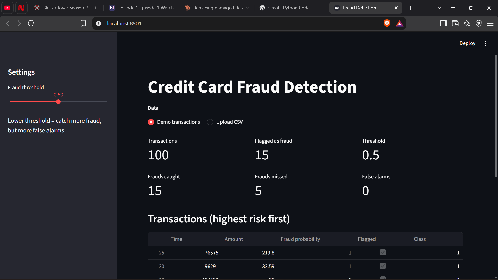
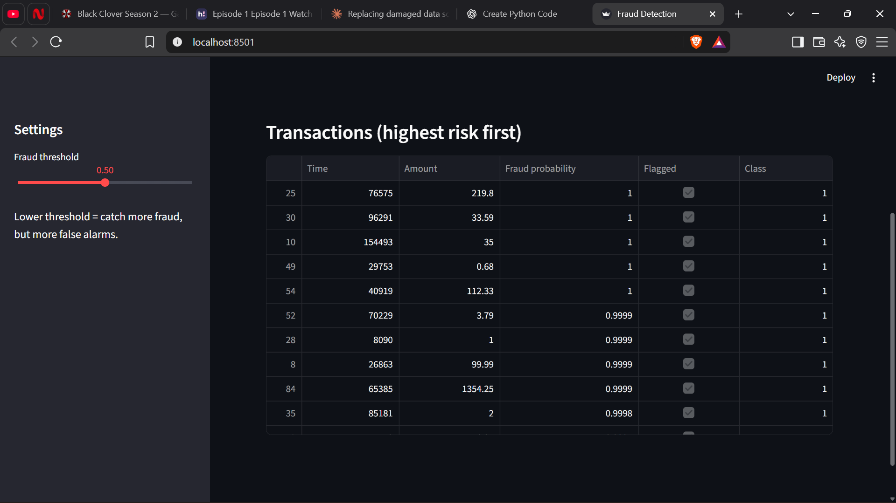
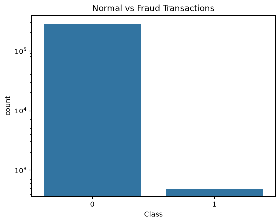
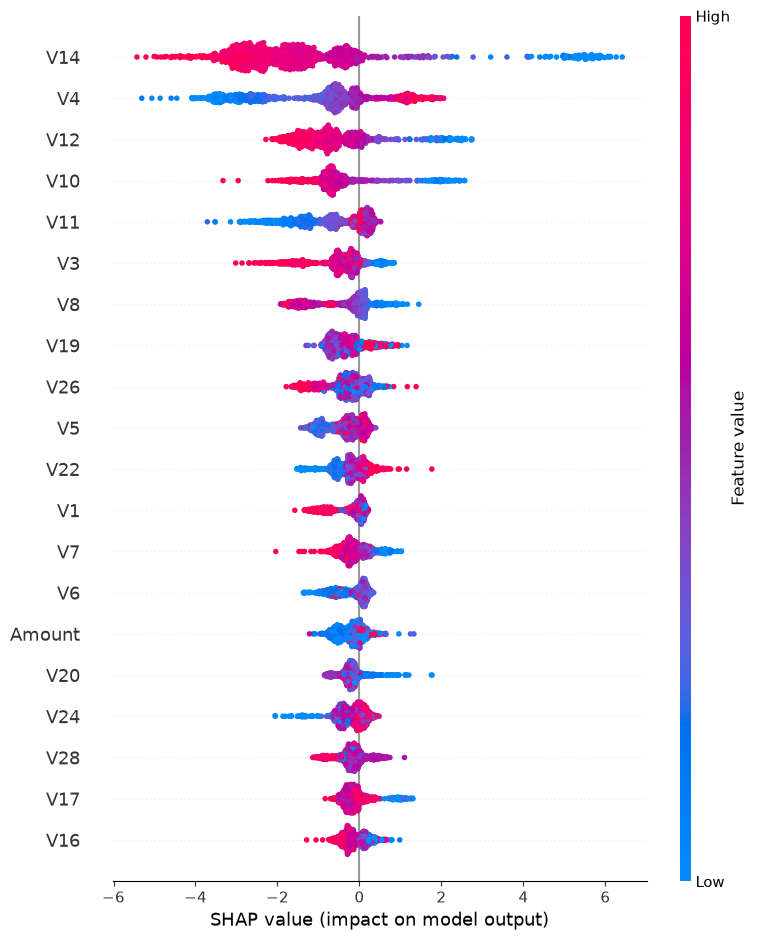

# 💳 Credit Card Fraud Detection System

A machine learning project that finds fraudulent credit card transactions. The data is highly imbalanced (only 0.17% of transactions are fraud), so the project focuses on handling that imbalance and judging models with the right metrics.

## Dataset
- Kaggle: [Credit Card Fraud Detection](https://www.kaggle.com/datasets/mlg-ulb/creditcardfraud) (European cardholders, 2 days)
- 284,807 transactions, 492 frauds
- Features `V1` to `V28` are PCA-transformed (anonymised), plus `Time` and `Amount`
- The dataset is not uploaded here because of its size. Download `creditcard.csv` and put it in the `data/` folder.

## What I did
1. **EDA**: checked class imbalance, amount, time of day and feature correlations
2. **Cleaning**: removed 1,081 duplicate rows (283,726 left), stratified 80/20 train-test split, scaled `Time` and `Amount` using train data only
3. **Baseline vs imbalance handling**: Logistic Regression with no handling, class weights and SMOTE (SMOTE on train data only)
4. **Model comparison**: Logistic Regression vs Random Forest vs XGBoost using stratified 5-fold CV on the training set
5. **Threshold tuning** using a cost-based approach, and **SHAP** to explain predictions
6. **Streamlit app** to score transactions with an adjustable threshold

## Results

**Step 1: Handling imbalance (Logistic Regression, test set)**

| Model | PR-AUC | Precision | Recall |
|---|---|---|---|
| Baseline | 0.695 | 0.862 | 0.590 |
| Class weights | 0.672 | 0.056 | 0.874 |
| SMOTE | 0.673 | 0.054 | 0.874 |

Class weights and SMOTE did not improve PR-AUC. They only moved the default cutoff, which gave high recall but a lot of false alarms.

**Step 2: Model comparison (5-fold CV on training data)**

| Model | PR-AUC | Std | ROC-AUC |
|---|---|---|---|
| Logistic Regression | 0.754 | 0.027 | 0.981 |
| Random Forest | 0.833 | 0.027 | 0.954 |
| **XGBoost** | **0.844** | 0.026 | 0.980 |

**Step 3: Final model on the test set (XGBoost)**

| PR-AUC | Precision | Recall | F1 | Caught | Missed | False alarms |
|---|---|---|---|---|---|---|
| 0.814 | 0.926 | 0.789 | 0.852 | 75 | 20 | 6 |

## Key findings
- **Accuracy and ROC-AUC are misleading here.** Logistic Regression had the best ROC-AUC (0.981) but the worst PR-AUC. I used PR-AUC to pick the model.
- **Threshold tuning:** I chose a threshold using training data, assuming a missed fraud costs 10 times a false alarm (this ratio is my assumption). The best threshold was 0.28, but on the test set it gave almost the same cost as the default 0.5, so the default was already close to the best choice.
- **SHAP:** the top drivers of fraud predictions are `V14`, `V4`, `V12`, `V10` and `V11`. These features are anonymised, so their real meaning is unknown.

## Project Screenshots

### Screenshot 1


### Screenshot 2


### Class Distribution


### SHAP Summary Plot


## Run it yourself
```
pip install -r requirements.txt
streamlit run app.py
```
Use Python 3.12 or 3.13. To retrain the model, download the dataset into `data/` and run `main.ipynb` from top to bottom.

## App
The Streamlit app loads a small demo sample (20% frauds, so it is easy to try) or any CSV with `Time`, `V1` to `V28` and `Amount`. A slider sets the fraud threshold. Lower values catch more fraud but give more false alarms.

## Tools
Python, pandas, NumPy, scikit-learn, imbalanced-learn, XGBoost, SHAP, Matplotlib, Seaborn, Streamlit